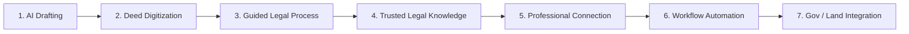

# ⚖️ Ain-AI (আইন-AI) — Bangladesh Legal-Tech Platform

[](https://www.python.org/)
[](https://fastapi.tiangolo.com/)
[](https://nextjs.org/)
[](https://tailwindcss.com/)
[](https://opencv.org/)
[](https://bdlaws.minlaw.gov.bd/)
[](LICENSE)

> **Empowering citizens and legal practitioners with intelligent legal documentation, handwritten land deed digitization, and step-by-step statutory guidance in Bangladesh.**

---

## 🎯 The Mission & Vision

Navigating the legal landscape in Bangladesh is often daunting, opaque, and cost-prohibitive for the average citizen. **Ain-AI (আইন-AI)** is building an accessible, tech-enabled Legal-Tech ecosystem designed to demystify the law and streamline legal workflows.

Rather than building an unwieldy monolith, we are solving high-impact legal challenges through modular, specialized prototypes that converge into a unified ecosystem.

### The Core Philosophy in One Line:
```
Understand the legal problem ➔ Guide the user ➔ Help prepare documents ➔ Digitize legal information ➔ Connect the right service ➔ Automate the workflow
```

> *"বাংলাদেশে legal information, documentation এবং legal-service processes সাধারণ মানুষের জন্য আরও সহজ, পরিষ্কার, structured এবং accessible করা।"*

---

## 🚀 Active Prototypes & Core Modules

### 1. ✍️ AI-Assisted Legal Drafting (Working Prototype)
A senior-advocate grade drafting studio producing 100% court-tested agreements and statutory notices grounded in Bangladesh law and senior legal scholarship (e.g., Dr. Syeda Nasrin's *Basics of Legal Drafting*, 2nd Ed.).

- **Conversational & Voice Intake:** Users can dictate case facts via Web Speech microphone (Bangla/English) or submit multi-paragraph real-world scenarios.
- **Senior Advocate Gap Detection:** Automatically detects omitted essential covenants (such as statutory 30-day security deposit refund, 10% annual rent escalation, sub-metering, and cardinal boundary schedules) and explains *why* they matter to avoid civil litigation.
- **Supported Standard Document Types:**
  - 🏬 **Commercial Lease Agreement** (16-clause authentic senior model, Premises Rent Control Act 1991 & Transfer of Property Act 1882)
  - 🏠 **Residential Tenancy Agreement** (15 clauses with statutory Section 13 rent receipt obligations)
  - 📜 **Section 138 NI Act Cheque Dishonour Demand Notice** (Strict 30-day statutory limitation notice)
  - 📑 **Immovable Property Sale Agreement (বায়না চুক্তিপত্র)** (Compliant with Registration Act 1908 s. 17A & Specific Relief Act 1877 s. 12)
  - 🤝 **Partnership Deed (অংশীদারি কারবার চুক্তিপত্র)** (Partnership Act 1932)
  - 💰 **Money Loan Agreement (হাওলাতনামা)** (Promissory undertaking & cheque collateral)
  - 👔 **Employment Contracts** (Bangladesh Labour Act 2006 compliance)
  - 🔒 **Non-Disclosure Agreements (NDA)** & Master Service Agreements
- **Export Ready:** One-click export to formatted Microsoft Word (`.docx`) and court-style printable PDF.

---

### 2. 🔍 Bangladesh Land Deed Digitization & Fraud Detection (Experimental OCR / HTR)
Old, historical, and handwritten land deeds (দলিল) in Bangladesh—dating back to 1947, 1972, or 1985—suffer from faded ink, degraded stamp paper, handwritten Bangla scripts, and complex layouts.

- **Computer Vision Preprocessing Pipeline:**
  - Multi-scale CLAHE (Contrast Limited Adaptive Histogram Equalization)
  - Sauvola/Otsu local binarization & deskewing
  - Morphological line segmentation using horizontal projection profile peak detection
- **Handwritten Bangla Extraction (HTR):**
  - Identifies First Party (দাতার নাম ও পিতা), Second Party (গ্রহীতা), and Sub-Registry Office.
  - Extracts Survey Khatian & Plot hierarchies: **C.S. (১৯৪০) ➔ S.A. (১৯৫৬-৬২) ➔ R.S. (১৯৬২-৮৮) ➔ B.S./City Survey**.
  - Extracts Land Area (শতক / কাঠা / একর) and Boundary demarcations (চৌহদ্দি: উত্তর, দক্ষিণ, পূর্ব, পশ্চিম).
- **8-Parameter Deed Fraud & Anomaly Engine:**
  - Validates historical survey chronology (e.g., flagging impossible timeline claims like 1952 deeds referencing 1962 RS surveys).
  - Cross-checks Sub-Registry territorial jurisdiction.
  - Detects duplicate stamp vendor series and mismatched Bayanama history.
- **Side-by-Side Verification UI:** Split-screen viewer with zoom, rotation, and live inline editor for quick human-in-the-loop verification.

---

## 🔮 Strategic Product Roadmap



| Phase | Module | Objective | Status |
| :--- | :--- | :--- | :--- |
| **Pillar 1** | **AI Legal Drafting** | Structured drafting for citizens & legal advocates | ✅ Active Prototype |
| **Pillar 2** | **Land Deed Intelligence** | Digitizing historical deeds, HTR, and fraud detection | 🔬 Experimental Dev |
| **Pillar 3** | **Guided Legal Process** | Step-by-step journey: *"My problem ➔ Where to go ➔ Required docs ➔ Next steps"* | 📋 In Design |
| **Pillar 4** | **Trusted Legal Information** | Plain-language, verified legal encyclopedia and statutory FAQ | 📋 In Design |
| **Pillar 5** | **Professional Connection** | Transparent marketplace connecting verified advocates and firms | 🔭 Roadmap |
| **Pillar 6** | **Workflow Automation** | Case tracking, diary management, and document pipelines for law chambers | 🔭 Roadmap |
| **Pillar 7** | **Digital Govt Integration** | APIs for Sub-Registry offices, Land Portals, and e-Judiciary services | 🔭 Long-term Vision |

---

## 🛠️ Architecture & Tech Stack

```
                                 ┌─────────────────────────────────────────┐
                                 │          Client / Presentation          │
                                 │  • Next.js 14 / React 18 + Tailwind     │
                                 │  • Unified Single-Port Dashboard (8000) │
                                 │  • Web Speech API (Bangla & English)    │
                                 └────────────────────┬────────────────────┘
                                                      │ HTTP / REST
                                 ┌────────────────────▼────────────────────┐
                                 │             FastAPI Backend             │
                                 │  • Intake Agent (Chat & Scenario)       │
                                 │  • Senior Drafting Engine (16 Covenants)│
                                 │  • Deed CV & HTR Engine (OpenCV)        │
                                 │  • Deed Fraud & Anomaly Verification    │
                                 │  • Export Service (DOCX & PDF)          │
                                 └────────────────────┬────────────────────┘
                                                      │
                       ┌──────────────────────────────┴──────────────────────────────┐
                       │                                                             │
            ┌──────────▼──────────┐                                       ┌──────────▼──────────┐
            │  SQLite / Postgres  │                                       │   Doc Storage & PDF │
            │  Legal Knowledge DB │                                       │   Templates & Fonts │
            └─────────────────────┘                                       └─────────────────────┘
```

- **Backend Framework:** FastAPI (Python 3.11+), Uvicorn, Pydantic v2
- **Data Persistence:** SQLAlchemy 2.0, SQLite (development) / PostgreSQL (production)
- **Computer Vision & Image Processing:** OpenCV (`cv2`), NumPy, SciPy, Pillow
- **Document Assembly & Output:** `python-docx`, ReportLab, Jinja2
- **Frontend Layer:** Next.js 14, Tailwind CSS, Lucide Icons, pure HTML5/ES6 responsive dashboard

---

## ⚡ Quickstart & Installation

### 1. Clone the Repository
```bash
git clone https://github.com/mdprince007/bangladesh-legal-tech.git
cd bangladesh-legal-tech
```

### 2. Backend Setup
```bash
cd backend
python -m venv venv

# On Windows:
.\venv\Scripts\activate
# On Linux/macOS:
source venv/bin/activate

pip install -r requirements.txt
pip install -r requirements-ocr.txt
```

### 3. Run the Unified Application
The platform is pre-configured to run both the FastAPI REST endpoints and the complete Advocate Dashboard from a unified single port:
```bash
# From the backend directory:
python -m uvicorn app.main:app --host 0.0.0.0 --port 8000 --reload
```

Open your browser and navigate to:
```
http://localhost:8000
```

- **Interactive UI Dashboard:** `http://localhost:8000/`
- **Swagger Interactive API Docs:** `http://localhost:8000/docs`
- **ReDoc API Reference:** `http://localhost:8000/redoc`

---

## 📂 Repository Structure

```
legeldraft/
├── backend/
│   ├── app/
│   │   ├── api/v1/          # REST API Endpoints (Drafting, Intake, Deeds, Advisory)
│   │   ├── core/            # Database engine and config
│   │   ├── models/          # SQLAlchemy ORM models
│   │   ├── schemas/         # Pydantic validation schemas
│   │   ├── services/        # Core business engines:
│   │   │   ├── drafting_engine.py          # 16-clause Nasrin-grounded legal drafting
│   │   │   ├── scenario_analysis_service.py # Voice/scenario gap analysis
│   │   │   ├── deed_cv_pipeline.py         # Multi-scale deed image enhancement
│   │   │   ├── deed_htr_engine.py          # Handwritten Bangla OCR/HTR
│   │   │   ├── deed_fraud_engine.py        # 8-rule historical timeline validation
│   │   │   └── export_service.py           # DOCX & PDF generation
│   │   └── static/          # Single-port unified Advocate UI (index.html, admin.html)
│   ├── storage/             # Generated legal documents and deed scans (git-ignored)
│   ├── requirements.txt     # Python dependencies
│   └── requirements-ocr.txt # Computer vision & OCR dependencies
├── frontend/                # Next.js 14 React client application
├── learning/                # Legal reference books & training materials
├── VISION.md                # Detailed product vision & Bengali strategic manifesto
├── README.md                # Project documentation and guide
└── .gitignore               # Multi-language git ignore rules
```

---

## ⚖️ Legal Disclaimer

*Ain-AI is a technology assistance tool designed to help citizens and legal professionals organize, draft, and digitize legal information. It does not constitute formal legal counsel. For high-stakes litigation, disputed property transactions, or court representation, users are strongly advised to consult an enrolled Advocate of the Bangladesh Bar Council or Supreme Court Bar Association.*

---

## 🤝 Contributing & License

Contributions, feedback, and partnerships from the legal fraternity and tech community in Bangladesh are warmly welcomed!

This project is licensed under the [MIT License](LICENSE).
